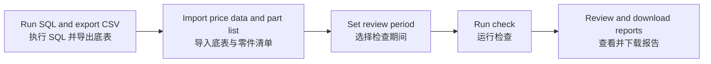

# Customer Price Review / 客户售价检查

[Open tool / 打开工具](https://sleepyliii.github.io/price-history-review/) · [SQL source / SQL 源码](Plex_export.sql)

Select a period, import a customer price export and a part list, then check selling-price details, changes and overlaps.

选择检查期间，导入客户价格底表和待检查零件清单，检查售价明细、价格变动及重叠区间。

## Workflow / 使用流程

## Use / 操作

1. Run [Plex_export.sql](Plex_export.sql) in Plex and export CSV. / 在 Plex 执行 SQL，导出客户价格底表 CSV。
2. Import the price CSV and an Excel (.xlsx/.xls) or CSV part list with part and revision headers (e.g. `PartNo,Rev`). Choose a worksheet if prompted. / 导入价格底表 CSV，以及含零件号、版本表头（如 `PartNo,Rev`）的 Excel（.xlsx/.xls）或 CSV 零件清单；多工作表时请选择需要的表。
3. Set start/end dates and run. Empty Revision means the blank version only. / 设置起止日期并运行；版本留空仅匹配系统空白版本。
4. Review PO selection and pending items, then download bilingual reports. / 核对 PO 筛选与待确认事项，下载双语报告。

## Reports / 输出

PO selection · Price changes · Overlapping prices · Processing status · Items requiring confirmation · Price history

PO 筛选 · 售价变动 · 多个有效售价 · 处理状态 · 待确认 · 价格明细

## Local development / 本机开发

`python -m http.server 8766 --bind 127.0.0.1` · `node --test engine.test.mjs parts-import.test.mjs`

GitHub Pages: `main` → `/ (root)`.

