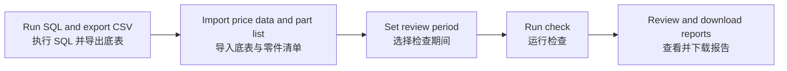

# Customer Price Review / 客户售价检查

[Open tool / 打开工具](https://sleepyliii.github.io/price-history-review/) · [SQL source / SQL 源码](Plex_export.sql)

Select a period, import a customer price export and a part list, then check selling-price details, changes and overlaps.

选择检查期间，导入客户价格底表和待检查零件清单，检查售价明细、价格变动及重叠区间。

## Workflow / 使用流程

## Use / 操作

1. Run [Plex_export.sql](Plex_export.sql) in Plex and export CSV. / 在 Plex 执行 SQL，导出客户价格底表 CSV。
2. Import the price CSV and an Excel (.xlsx/.xls) or CSV part list with part and revision headers (e.g. `PartNo,Rev`). Choose a worksheet if prompted. / 导入价格底表 CSV，以及含零件号、版本表头（如 `PartNo,Rev`）的 Excel（.xlsx/.xls）或 CSV 零件清单；多工作表时请选择需要的表。
3. Set start/end dates and run. Empty Revision means the blank version only; one-digit numeric revisions match padded versions (9 = 09). / 设置起止日期并运行；版本留空仅匹配系统空白版本；一位数字版本补零匹配（9 = 09）。
4. Review current PO prices and pending items, then download bilingual reports. / 核对当前 PO 价格与待确认事项，下载双语报告。

Current PO prices use the selected period end date and show qualified POs across all customers. / 当前 PO 价格以所选检查期间的结束日为准，显示所有客户符合条件的 PO 售价。

Overlap checks require `Price_Active` from the updated SQL. Only currently active prices participate; inactive records remain in history and price-change comparisons. / 重叠检查需要新版 SQL 的 `Price_Active` 列；仅纳入当前有效价格，inactive 记录仍保留在历史和调价比较中。

Select POs separately for each part / revision / customer. Blanket POs with positive Releases take priority. If all Blanket Releases are zero, use the latest Blanket PO date; tied dates require confirmation except for the GM batch rule below. / 每个零件／版本／客户分别筛选 PO。优先选择 Releases > 0 的 Blanket；全部为零时按最新 Blanket PO 日期选择；最新日期并列需确认（GM 使用下述批次规则）。

When the latest earlier effective date has multiple old prices, prefer the price expiring the day before the new price. Multiple different qualifying prices still require confirmation. / 前序最近生效日有多个旧价时，优先采用新价前一天失效的旧价；仍有多个不同价格符合时需确认。

GM group: GMNA, GM-NA 1, GMCCA, GM Canada SPO, GM Henniges, GM Henniges SPO. Re-export with the updated SQL to include approved Ship-to keys, codes, status and Releases. GM selects the latest batch per customer/Ship-to and retains same-day POs. All branches must have the same valid price, currency and unit on the period end date to confirm a common price; unresolved branches stay pending. / GM 按客户＋Ship-to 选最新批次并保留同日 PO；需用新版 SQL 重新导出地址、状态和地址级 Releases。以检查结束日比价，价格、币种和单位一致且无未确定分支才确认共同售价。

All customer/PO prices are rounded half-up to four decimal places before changes, overlaps and GM consistency checks. Original amounts remain in the history export. / 所有客户及 PO 的售价均先四舍五入至四位，再检查调价、重叠及 GM 一致性；历史导出保留原始金额。

Spot Buy POs and Spot Buy-only branches are excluded from comparison, not treated as unresolved Blanket candidates. Legacy `Other` exports with validated PCN 269388 / type key 2501 are supported. Other unconfirmed types remain pending. / Spot Buy PO 及只有 Spot Buy 的分支不参与比较，不进入待确认；兼容旧导出的 Other＋2501，其他未确认类型仍需核对。

For GM current-price consistency, exclude selected PO/Ship-to rows with no Active effective price anywhere in the review period. A price valid earlier in the period but expired by period end remains pending. History/change audit is retained. If every row is excluded, show excluded with no common price. / GM 当前价比对中，整期无 Active 有效价的 PO／地址明细排除；期间曾有价但结束日无价仍待确认。保留历史及调价检查；全部排除时不确认共同售价。

Different Active prices effective on the same PO at period end require confirmation; no price is chosen automatically. The overlap report is retained. / 同一 PO 在结束日存在多个不同 Active 有效价时列入待确认，不自动选价；保留重叠报告。

For same-day new-price corrections, use Active candidates when present; inactive records stay in history. Historical previous-price comparisons are preserved. / 同日新价有更正记录且存在 Active 候选时，仅用 Active 新价比较；inactive 仍保留历史，前序历史价格比较保持原规则。

## Reports / 输出

Current PO prices · Price changes · Overlapping prices · Items requiring confirmation · Price history · GM current prices · GM price consistency

当前 PO 价格 · 售价变动 · 多个有效售价 · 待确认 · 价格明细 · GM 当前价格 · GM 价格一致性

## Local development / 本机开发

`python -m http.server 8766 --bind 127.0.0.1` · `node --test *.test.mjs`

GitHub Pages: `main` → `/ (root)`.

